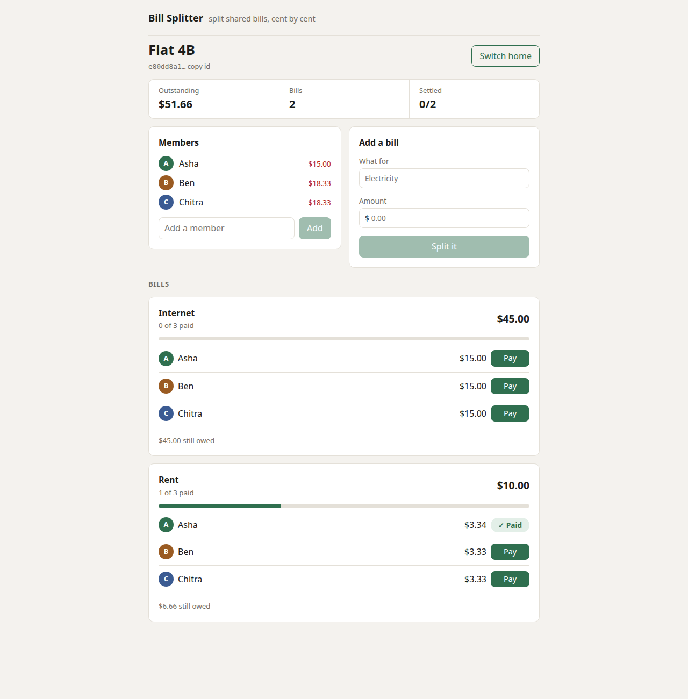
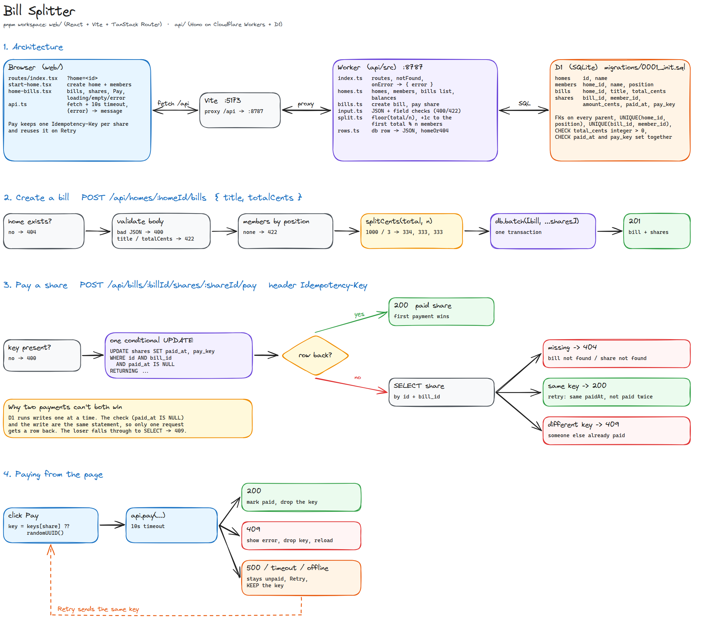

# Shared Bill Splitter

A small bill splitter for a shared home. You create a home, add the people who live there, add a
bill, and it gets split between everyone down to the cent. Each person pays their own share.

Built for the DoCoDeGo SDE intern assignment. The original brief is in
[docs/ASSIGNMENT.md](docs/ASSIGNMENT.md).

**Video walkthrough:** _add link here_



**Stack:** Hono on Cloudflare Workers, D1 (SQLite), React + Vite + TanStack Router, TypeScript,
Vitest in the Workers runtime, Biome.

## Run it

Needs Node 22 and pnpm.

```bash
pnpm install
pnpm dev          # api on :8787, web on :5173
```

Open http://localhost:5173, create a home with a few members, then add bills and pay shares.
`pnpm dev` applies the migrations to a local D1 database before the api starts.

```bash
pnpm test         # 39 tests: the 24 visible ones + 15 of my own
pnpm check        # Biome format + lint
pnpm typecheck    # tsc on both packages
pnpm build        # production build of the web app
```

Notes:

- Wait for `Ready on http://localhost:8787` before using the page. Vite starts a few seconds
  earlier, and `/api` calls get a 502 until the api is up.
- If Vite says it moved to port 5174, an older `pnpm dev` is still running. Stop it and start
  again, because the web proxy always talks to the api on 8787.
- If pnpm says build scripts were ignored, run `pnpm approve-builds` and allow `esbuild` and
  `workerd`.

### Docker (optional)

`pnpm dev` is the main way to run it. If your local Node or pnpm setup gives trouble, the same
thing runs in one container:

```bash
docker compose up -d --build        # api on :8787, web on :5173
docker compose exec app pnpm test   # tests inside the container
docker compose down
```

Don't run this and `pnpm dev` at the same time, because they use the same ports.

## Architecture



The editable version is [docs/architecture.excalidraw](docs/architecture.excalidraw). Open it at
excalidraw.com or with the VS Code Excalidraw extension.

```
api/
  migrations/0001_init.sql   schema + named constraints
  src/index.ts               routes, 404 + error handler (every error is { error })
  src/homes.ts               homes, members, bills list, balances
  src/bills.ts               create bill, pay share
  src/split.ts               the cent split
  src/input.ts               JSON body + field validation
  src/rows.ts                db row -> JSON, homeOr404
  test/edge-cases.test.ts    my tests (the other test files are the visible ones, unchanged)
web/
  src/api.ts                 fetch wrapper: 10s timeout, readable errors
  src/routes/index.tsx       the page, home id in ?home=
  src/components/            start screen, bills view
```

## API

| Method | Path                                     | Success                                         | Errors               |
| ------ | ---------------------------------------- | ----------------------------------------------- | -------------------- |
| POST   | `/api/homes`                             | `201 { id, name }`                              | 400, 422             |
| POST   | `/api/homes/:homeId/members`             | `201 { id, homeId, name }`                      | 404, 400, 422        |
| POST   | `/api/homes/:homeId/bills`               | `201 { id, homeId, title, totalCents, shares }` | 404, 400, 422        |
| POST   | `/api/bills/:billId/shares/:shareId/pay` | `200 { id, memberId, amountCents, paidAt }`     | 400 no key, 404, 409 |
| GET    | `/api/homes/:homeId/balances`            | `200 { balances }`                              | 404                  |
| GET    | `/api/homes/:homeId`                     | `200 { id, name, members }`                     | 404                  |
| GET    | `/api/homes/:homeId/bills`               | `200 { bills }` newest first, with shares       | 404                  |

The last two are not in the brief. The page needs them to show a home and its bills. Every error is
JSON: `{ "error": "message" }`. A bad JSON body is a `400`, and a field that fails validation is a `422`.

## The required cases

| Case                                        | What happens                                                                                        | Covered by                      |
| ------------------------------------------- | --------------------------------------------------------------------------------------------------- | ------------------------------- |
| Home with no members                        | `422` when adding a bill. The page disables "Add bill" until there is a member.                     | bills.test, page                |
| Amount zero, negative, decimal, or a string | `422` from the api. `bills_total_positive_int` would reject it in the database too.                 | bills.test, edge-cases.test     |
| Amount that doesn't divide evenly           | `floor(total / n)` each, then +1 cent to the first `total % n` members by join order                | bills.test, edge-cases.test     |
| Same payment sent twice                     | Same `Idempotency-Key` → same `200` and same `paidAt`. Paid once.                                   | payments.test, edge-cases.test  |
| Two people paying the same share at once    | One conditional `UPDATE`, so only one wins. The other gets `409`, or `200` if it sent the same key. | edge-cases.test (3 racing pays) |
| Bill or share that doesn't exist            | `404` with `bill not found` or `share not found`. A share can't be paid through another bill.       | payments.test, edge-cases.test  |
| API returns 500 or is slow                  | 10s timeout, error shown, share stays unpaid, Retry. A root error boundary stops a blank screen.    | page                            |

## Data model

Four tables: `homes`, `members`, `bills`, `shares`. Money is always `INTEGER` cents.

| Constraint                                                               | Stops                                                                    |
| ------------------------------------------------------------------------ | ------------------------------------------------------------------------ |
| `members_home_fk`, `bills_home_fk`, `shares_bill_fk`, `shares_member_fk` | rows pointing at a home, bill or member that doesn't exist               |
| `members_position_per_home`                                              | two members with the same join order in one home                         |
| `shares_one_per_member`                                                  | a member getting two shares of the same bill                             |
| `bills_total_positive_int`                                               | zero, negative or decimal totals, even if the api check is skipped       |
| `shares_amount_non_negative`                                             | negative or decimal share amounts                                        |
| `shares_paid_has_key`                                                    | a share marked paid without the key that paid it, or the other way round |
| `*_not_blank`                                                            | empty names and titles                                                   |

## Decisions

1. **Paying a share is one conditional `UPDATE`.**
   `UPDATE shares SET paid_at = ?, pay_key = ? WHERE id = ? AND bill_id = ? AND paid_at IS NULL RETURNING ...`.
   D1 runs writes one after another, so when two requests race, only one gets a row back. The loser
   reads the share. If its key matches the stored `pay_key`, it is a retry and gets the same `200`.
   Otherwise it gets `409`. I didn't add a separate idempotency table. The key lives on the share,
   because a share can only be paid once anyway. The `shares_paid_has_key` check makes sure `paid_at`
   and `pay_key` are always set together.

2. **Member order is a `position` column, not `created_at`.**
   The split gives the extra cents to members in the order they were added, so that order must be
   exact. Timestamps can tie inside the same millisecond. `position` is computed inside the insert
   (`SELECT COALESCE(MAX(position), 0) + 1 ...`), and `UNIQUE (home_id, position)` stops two members
   from ever getting the same slot. The bill and all its shares are written in one `db.batch`, so a
   bill never exists without its shares.

3. **The web page reuses the idempotency key when you retry.**
   Each share gets a key the first time you press Pay. If the request fails or times out (10s), the
   share stays unpaid, an error is shown, and the button becomes Retry. Retry sends the same key, so a
   payment that reached the server but whose response got lost is not paid twice. The key is dropped
   only after a definite answer (`200`, `404`, or `409`). On `409` the page reloads the bills, because
   someone else paid the share. I used plain `fetch` and React state instead of a data library. The
   page is small, and I wanted to be able to explain every state it can be in.

## What I'd do next

- **Auth.** Right now anyone with a home id can see and pay its bills.
- **A proper idempotency table**, if payments ever become partial or a share can be paid more than
  once. The key-on-the-share approach only works because each share is paid exactly once.
- **Members who join later.** A member added after a bill is not part of that bill's split, which is
  probably right, but the page doesn't explain it.
- **Removing members and bills.** The foreign keys already cascade, but there are no endpoints yet.
